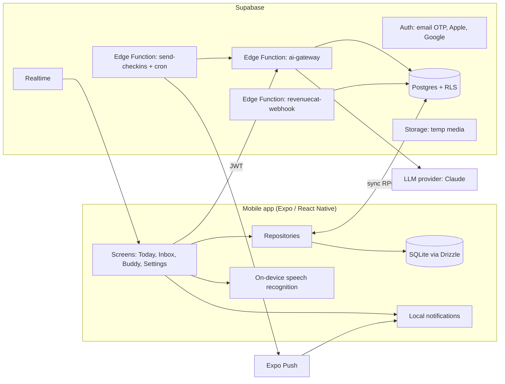

# Task Buddy — Architecture & Tech Stack Notes

## 1. System overview

## 2. Key design decisions

1. **Local-first.** Tasks live in SQLite and the app works fully offline. Supabase is the sync target and the home of AI, push and shared spaces. This keeps the daily experience fast and resilient.
2. **One AI gateway.** A single Supabase Edge Function is the only code that talks to the LLM. It verifies the user's JWT, applies per-user rate limits and a daily token quota, validates the request and the model output against shared Zod schemas (one repair retry, then `AI_BAD_OUTPUT`), logs usage to `ai_usage_ledger`, and routes each route to a model (cheaper model for parse and check-ins, stronger model for plan, chat and weekly review). The API key exists only as a function secret.
3. **AI proposes, user confirms.** The gateway never executes actions from user text. Chat and agent responses return *proposals*; the client applies them only after the user taps Confirm. In Shared Spaces proposals are stored in `agent_actions` and scoped by owner-defined permissions.
4. **Structured output everywhere.** Natural-language capture, breakdown, plan and review are JSON-schema contracts so UI code never parses prose.
5. **Sync v1 = last-write-wins with tombstones.** Good enough for one user across devices. Shared Spaces raise the bar (realtime, concurrent edits); the plan keeps a decision point to adopt a sync engine or CRDT before Sprint 8 if the two-client tests expose lost updates.
6. **Privacy by design.** Raw photos and audio are deleted within 24 hours, task text is never written to logs or analytics, analytics is consent-gated, and users can export and delete their data.

## 3. Recommended tools and tech stack (and why)

| Need | Tool | Why | Alternative if it does not fit |
|---|---|---|---|
| App framework | Expo + React Native + TypeScript, Expo Router | One codebase, OTA updates, great DX. Expo SDK 56 (May 2026) is confirmed stable; SDK 57 is listed on expo.dev/sdk (dated June 30, 2026), so use the latest stable at scaffold time | Bare React Native |
| Styling | NativeWind | Tailwind-style utilities, theme tokens, dark mode | Unistyles, StyleSheet |
| State | Zustand + TanStack Query | Small and predictable; Query handles loading/error/caching | Redux Toolkit |
| Forms | React Hook Form + Zod | One schema validates user input and AI output | Formik |
| Local DB | expo-sqlite + Drizzle | Offline-first, typed queries, FTS5 search | WatermelonDB |
| Backend | Supabase | Auth, Postgres, Realtime, Storage and Edge Functions in one place; RLS enforces isolation | Firebase |
| LLM | Claude via the gateway | Strong structured output and tool use; keys stay server-side | Any provider behind the same interface |
| Voice | expo-speech-recognition | On-device recognition where supported, free, no extra vendor. Needs a development build; community-maintained, so check release status before Sprint 6 | Cloud speech-to-text as fallback |
| Photo | expo-image-picker / camera + vision model via gateway | Reuses gateway guardrails | Separate OCR service |
| Notifications | expo-notifications + Expo Push | Local reminders work offline; push for check-ins | OneSignal |
| Widgets | Expo Widgets (iOS stable in SDK 56) | Native home-screen widget without custom native code | Native module; Android approach decided in Phase 3 |
| Billing | RevenueCat | Handles receipts and entitlements for both stores | Native billing |
| Crash/analytics | Sentry + PostHog | Standard; PostHog is consent-gated | Crashlytics |
| Testing | Jest + RNTL, Maestro, custom AI eval runner | Covers logic, user flows and AI regressions | Detox |
| CI/CD | GitHub Actions + EAS Build / Submit / Update | Matches the Expo workflow | Bitrise |
| Agent skills | Expo skills (`npx skills add expo/skills` or the Claude Code plugin), Supabase agent skills | Keeps AI coding agents on current best practice | — |

## 4. AI gateway routes

| Route | Purpose | Model class | Output schema |
|---|---|---|---|
| `/parse` | Sentence to tasks | cheap/fast | `ParsedTasks` |
| `/breakdown` | Task to subtasks | cheap/fast | `Breakdown` |
| `/plan` | Daily schedule | stronger | `Plan` |
| `/starter-step` | Tiny first step | cheap/fast | `StarterStep` |
| `/chat` (SSE) | Buddy chat with proposals | stronger | text + `Proposal` events |
| `/review` | Weekly review | stronger | `WeeklyReview` |
| `/vision-extract` | Photo to tasks | vision-capable | `ParsedTasks` |
| `/space-agent` (SSE) | Shared agent | stronger | text + `Proposal` events |

Guardrails on every route: JWT, request size cap (2,000 characters of text), per-user hourly limit, daily token quota, usage ledger row, prompt version logged, injection test corpus in CI, output validation.

## 5. Sync design (v1)

- Every synced row has `id` (UUIDv7), `updated_at`, `deleted_at`, plus a server-assigned `server_seq` in Postgres.
- `sync_push(ops[])` applies local changes (conflicts resolved by the later `updated_at`; conflicts are returned to the client); `sync_pull(since_seq)` returns changes after the last seen sequence.
- Deletes are tombstones, purged after 30 days.
- Mandatory automated test: two clients editing the same task offline converge with no loss or duplicates.

## 6. Shared Spaces (Phase 3)

- Tables: `spaces`, `space_members` (role owner/editor/viewer), `space_invites` (hashed codes, expiry), `task_comments`, `agent_actions`.
- RLS ensures only members read a space's rows; tests prove cross-space isolation.
- Realtime channels per space; changes also flow through sync so offline edits merge.
- The `@buddy` agent sees only the current space's tasks and comments, with scopes (read, propose, apply) enforced in the gateway; state-changing actions need human approval unless the owner enables auto-apply for a scope; everything is written to an immutable audit log.

## 7. Security and privacy checklist

- RLS on every table, with tests in `supabase/tests`.
- No secrets in the bundle; only `EXPO_PUBLIC_*` non-secret values.
- Tokens in `expo-secure-store`.
- Prompt-injection corpus in CI; AI actions always user-confirmed.
- PII scrubbed from Sentry; no task text in logs or analytics.
- Account deletion and data export before store release.
- AI disclosure and consent copy for text, audio and image processing.

## 8. Cost control

- Cheap model for high-volume routes; stronger model only where quality matters.
- Per-user hourly limits and daily token quotas from day one; tiered quotas with billing.
- Every call logged to `ai_usage_ledger` with token counts and an estimated cost; a SQL view and a daily spend alert.
- Decide free/Pro limits after about four weeks of real ledger data (see *Gaps & Assumptions*).

## 9. Open items to confirm

See the workbook's *Gaps & Assumptions* tab. The most important: velocity and start date, iOS-only vs both platforms in v1.0, AI provider data terms for the privacy policy, speech-recognition support for Filipino (fil-PH) on target devices, and Android widget approach.
